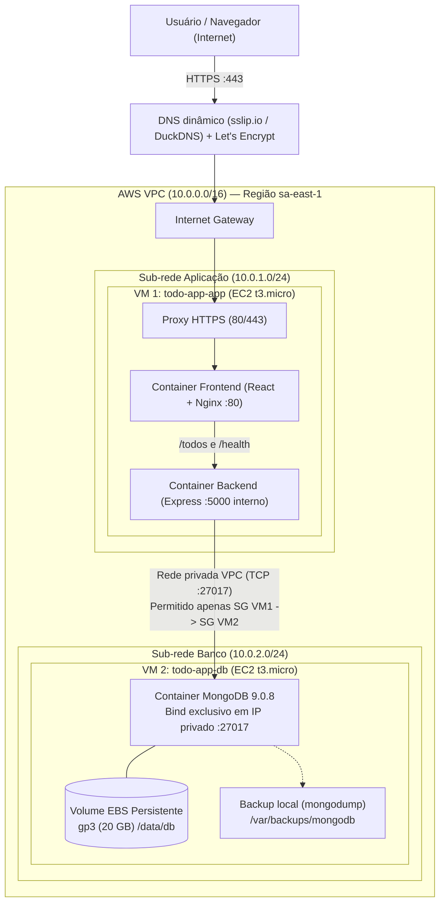
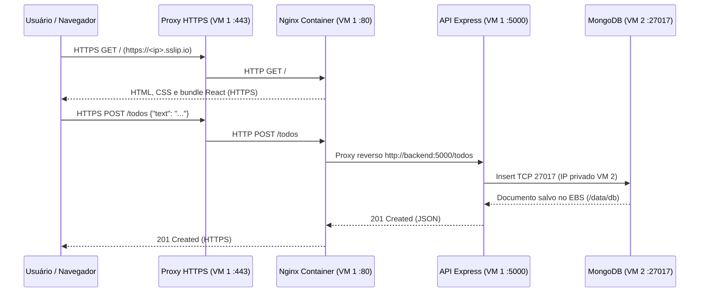

# Arquitetura da Infraestrutura — ToDo App na AWS

**Região padrão:** `sa-east-1` (São Paulo)  
**Estratégia HTTPS:** Subdomínio dinâmico gratuito (`<IP-PUBLICO>.sslip.io` ou DuckDNS) com certificado Let's Encrypt automático na VM da aplicação  
**Automação:** Terraform (provisionamento) + Ansible (configuração e deploy) + GitHub Actions (CI/CD manual)

---

## 1. Comparação de Provedores e Justificativa

Antes de definir o desenho final, foram avaliadas as principais opções compatíveis com Terraform para um projeto acadêmico de 2 VMs:

| Provedor | Pontos Positivos | Pontos de Atenção / Consequências |
| :--- | :--- | :--- |
| **AWS (EC2 + VPC + EBS)** *(escolhido)* | Amplo ecossistema Terraform, suporte maduro a Security Groups por origem, Free Tier (`t3.micro`/`t2.micro` + EBS), ampla documentação e mercado. | IPv4 público possui cobrança por hora (~US$ 0,005/h); NAT Gateway é caro (~US$ 0,065/h em `sa-east-1`), exigindo desenho econômico sem NAT. |
| **GCP (Compute Engine)** | Créditos iniciais generosos, rede global simples. | Exige projeto/billing ativo; menor familiaridade da equipe para regras equivalentes ao modelo AWS. |
| **Azure (Virtual Machines)** | Boa integração corporativa e créditos estudantis. | Criação de vários recursos auxiliares (NIC, NSG, Public IP separados) torna o Terraform mais verboso. |
| **DigitalOcean / Oracle Cloud** | Preço fixo previsível (DO) ou Always Free ARM (OCI). | Menor disponibilidade de cotas Free Tier (OCI) ou ausência de Free Tier contínuo (DO). |

**Decisão:** adotar **AWS** na região **`sa-east-1` (São Paulo)** pela menor latência para acesso no Brasil durante a apresentação, aderência aos requisitos do laboratório e facilidade de provisionamento via Terraform.

---

## 2. Visão Geral da Arquitetura



---

## 3. Função de Cada Máquina Virtual

| Recurso | Tipo Sugerido | Função | Componentes |
| :--- | :--- | :--- | :--- |
| **VM 1 (`todo-app-app`)** | `t3.micro` (2 vCPU, 1 GB RAM) | Exposição pública HTTPS, entrega do frontend estático e execução da API REST. | Docker Engine, proxy TLS (portas `80`/`443`), container `frontend` (`nginx:1.31.10-alpine` + React), container `backend` (`node:18.20.8-alpine` + Express). |
| **VM 2 (`todo-app-db`)** | `t3.micro` (2 vCPU, 1 GB RAM) | Hospedagem exclusiva e isolada do banco de dados e rotinas de backup. | Docker Engine, container `mongo:9.0.8`, volume EBS dedicado para `/data/db`, utilitários de backup (`mongodump`/`mongorestore`). |

---

## 4. Rede Pública, Rede Privada e Decisão Econômica (Sem NAT Gateway)

- **VPC:** `10.0.0.0/16` com DNS habilitado.
- **Sub-rede da Aplicação (`10.0.1.0/24`):** sub-rede pública com rota padrão (`0.0.0.0/0`) via Internet Gateway (`IGW`), atribuindo IP público à VM 1 para tráfego HTTP/HTTPS dos visitantes.
- **Sub-rede do Banco (`10.0.2.0/24`):** sub-rede separada logicamente para o MongoDB.
- **Por que evitar NAT Gateway neste projeto:**
  - Um NAT Gateway na AWS `sa-east-1` custa cerca de **US$ 0,065/hora (~US$ 47/mês)** além do tráfego processado.
  - Para manter o ambiente acessível pelo Ansible (instalação de pacotes/Docker e pull de imagem `mongo:9.0.8`) sem NAT Gateway, a VM 2 recebe IP público administrativo apenas quando `db_associate_public_ip = true` (configurável), **porém sem qualquer abertura da porta `27017` para a internet**.
  - Como segunda camada de proteção (defesa em profundidade), o container MongoDB (`deploy/docker-compose.db.yml`) faz bind **exclusivamente no IP privado da VM 2** (`${MONGO_PRIVATE_IP}:27017:27017`), impedindo qualquer escuta na interface pública.

---

## 5. Regras de Firewall (Security Groups) e Portas Permitidas

### Security Group da VM 1 — Aplicação (`sg-app`)

| Direção | Protocolo / Porta | Origem / Destino | Finalidade |
| :--- | :---: | :--- | :--- |
| **Ingress** | TCP `80` | `0.0.0.0/0` | Redirecionamento HTTP -> HTTPS e desafio ACME (Let's Encrypt) |
| **Ingress** | TCP `443` | `0.0.0.0/0` | Acesso público HTTPS ao frontend e `/todos` |
| **Ingress** | TCP `22` | `var.admin_cidr` (IP administrativo) | Administração e execução do Ansible via SSH |
| **Egress** | Todos | `0.0.0.0/0` | Atualizações de pacotes, pull de imagens, conexão ao banco e Let's Encrypt |

### Security Group da VM 2 — Banco de Dados (`sg-db`)

| Direção | Protocolo / Porta | Origem / Destino | Finalidade |
| :--- | :---: | :--- | :--- |
| **Ingress** | TCP `27017` | **`sg-app` (somente VM 1)** | Conexão privada da API Express ao MongoDB |
| **Ingress** | TCP `22` | `var.admin_cidr` (IP administrativo) | Administração e execução do Ansible via SSH |
| **Egress** | Todos | `0.0.0.0/0` | Atualizações de SO, instalação do Docker e pull da imagem do MongoDB |

**Portas bloqueadas publicamente:**
- Porta `5000` (API Express): **nunca exposta** na internet; acessível apenas internamente pelo proxy reverso Nginx na VM 1.
- Porta `27017` (MongoDB): **nunca exposta** para `0.0.0.0/0`; aceita conexões apenas de instâncias associadas a `sg-app` pela rede privada da VPC (`10.0.0.0/16`).

---

## 6. Fluxo Completo do Usuário até o Banco



---

## 7. Estratégia de Persistência, Backup e Restauração

### Persistência
- **Nível de infraestrutura (AWS):** volume EBS dedicado (`aws_ebs_volume`, `gp3`, `20 GB` padrão) anexado à VM 2, formatado em `ext4` e montado em `/mnt/mongo-data` (ou `/opt/todo-app/mongo-data`) via Ansible.
- **Nível de container (Docker):** o volume nomeado/bind do MongoDB persiste `/data/db` dentro desse disco EBS dedicado, sobrevivendo a `docker compose down`, atualização de containers e reinicializações da VM.

### Backup
- Execução de `mongodump` dentro ou conectado localmente ao container `mongo-todo` na VM 2, autenticando via variáveis de ambiente protegidas (sem credenciais na linha de comando/logs visíveis, usando `--uri` via arquivo/env protegido ou stdin).
- Armazenamento em diretório protegido (`/var/backups/mongodb` com permissão `0700` para `root`), nomeado com timestamp (`todo-app-YYYYMMDD-HHMMSS.archive.gz`) e retenção configurada (ex.: últimos 7 ou 14 backups).

### Restauração
- Teste e validação sempre executados em **container ou banco isolado** (ex.: container temporário `mongo-restore-test` ou banco `todo-app-restore-test`) com `mongorestore --archive=... --gzip`.
- Apenas após validar contagem de documentos e integridade, promove-se a restauração para o ambiente principal em caso de incidente real.

---

## 8. Estratégia de HTTPS e Segredos

### HTTPS sem domínio pago
1. Após o Terraform criar a VM 1 e devolver o `app_public_ip` (ex.: `54.232.10.20`), utiliza-se o serviço gratuito de DNS reverso **`54-232-10-20.sslip.io`** (ou subdomínio gratuito no **DuckDNS** apontando para o IP).
2. Na VM 1, o proxy reverso TLS (Caddy ou Nginx + Certbot) solicita automaticamente um certificado **Let's Encrypt** válido para esse hostname, escutando em `443` (HTTPS) e redirecionando `80` (HTTP) para `443`.
3. O frontend e a API respondem sob o mesmo domínio HTTPS (`https://<host>/` e `https://<host>/todos`), eliminando problemas de conteúdo misto e CORS.

### Estratégia de Secrets
- Nenhum segredo é versionado no Git (`.env`, `*.tfvars`, `*.tfstate`, chaves SSH e inventários estão protegidos no [.gitignore](.gitignore)).
- Credenciais AWS, chave SSH privada e senhas do MongoDB ficam armazenadas exclusivamente em **GitHub Secrets** (ou **Ansible Vault** / variáveis locais não versionadas).
- Em tempo de deploy, o Ansible gera os arquivos `.env` nas VMs com permissão restrita (`0600`) e `no_log: true`.

---

## 9. Estimativa de Recursos e Custos (Referência `sa-east-1`)

> **Premissas:** preços públicos estimados sob demanda na região `sa-east-1` (São Paulo) em USD; uso contínuo mensal (`730 horas/mês`) vs. janela acadêmica de preparação e apresentação (`~40 horas` no mês). Contas AWS elegíveis ao **Free Tier** podem zerar parte das horas de `t3.micro` e até 30 GB de EBS.

| Recurso | Especificação | Custo Mensal Estimado (Sem Free Tier) | Custo Estimado 40h (Apresentação) | Observação |
| :--- | :--- | :---: | :---: | :--- |
| **EC2 VM 1 (Aplicação)** | `1x t3.micro` Linux (~US$ 0,0168/h em `sa-east-1`) | ~US$ 12,26 | ~US$ 0,67 | Elegível ao Free Tier (750h/mês compartilhadas) em contas novas |
| **EC2 VM 2 (MongoDB)** | `1x t3.micro` Linux (~US$ 0,0168/h em `sa-east-1`) | ~US$ 12,26 | ~US$ 0,67 | Com 2 VMs, 730h x 2 excedem 750h/mês no mês cheio |
| **Volumes EBS `gp3`** | `2x 20 GB` raiz + `1x 20 GB` dados = `60 GB` (~US$ 0,152/GB-mês em `sa-east-1`) | ~US$ 9,12 | ~US$ 0,50 (proporcional) | Free Tier cobre até 30 GB/mês de EBS |
| **IPv4 Públicos** | `2x` IPv4 públicos (`US$ 0,005/h` cada na AWS) | ~US$ 7,30 | ~US$ 0,40 | Cobrado mesmo dentro do Free Tier (ou US$ 3,65 se VM 2 não tiver IP público) |
| **Transferência / Outros** | Tráfego leve (< 5 GB) + Let's Encrypt + `sslip.io` | ~US$ 0,00 – US$ 0,50 | ~US$ 0,00 | 100 GB/mês de saída inclusos no Free Tier |
| **Total Estimado** | — | **~US$ 41/mês** *(ou ~US$ 16–20 com Free Tier)* | **~US$ 2,24** *(ou < US$ 1,00 com Free Tier)* | Desligar/destruir após uso mantém custo próximo de zero |

*(Nota: o provedor na região `us-east-1` seria ~35% mais barato caso desejem reduzir ainda mais custos.)*

---

## 10. Limitações da Arquitetura

1. **Sem alta disponibilidade (Single-AZ):** cada serviço possui apenas 1 instância EC2; reinicializações causam breve indisponibilidade.
2. **Escalabilidade vertical/manual:** para suportar tráfego muito maior, seria necessário aumentar `instance_type` ou introduzir Load Balancer + réplica de banco.
3. **IP público dinâmico por padrão:** ao destruir e recriar a VM 1, o IP público muda (atualizando automaticamente o subdomínio `sslip.io` pelo novo output do Terraform).
4. **Rate limit do Let's Encrypt:** recriar a VM muitas vezes seguidas para o mesmo domínio pode atingir limites de emissão de certificados do Let's Encrypt (mitigável usando staging durante testes).

---

## 11. Procedimento de Desligamento e Recursos que Podem Gerar Custo

1. **Encerramento completo da infraestrutura:**
   ```bash
   cd terraform
   terraform destroy
   ```
2. **Checklist pós-`destroy` (conferir no Console AWS em `sa-east-1`):**
   - Instâncias EC2 encerradas (`terminated`);
   - Volumes EBS removidos (especialmente o volume de dados do MongoDB, caso não esteja marcado para retenção);
   - Elastic IPs liberados (IPv4 alocado e não associado gera cobrança de US$ 0,005/h);
   - Snapshots EBS manuais e objetos em buckets S3 (se usados para backup ou state remoto) continuam gerando cobrança por GB armazenado até serem excluídos.

