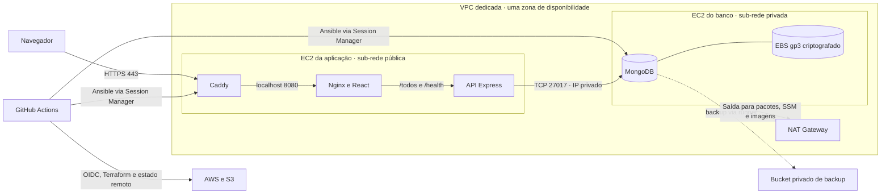

# Arquitetura do PM-04 · ToDo App na AWS

A demanda da Feira de Profissões pede uma URL pública HTTPS e duas VMs, com MongoDB dedicado, isolado e persistente. AWS foi escolhida pela disponibilidade de EC2, EBS, Session Manager e S3 na região de São Paulo, além da integração do GitHub Actions com a AWS por OpenID Connect (OIDC).

- O IP público fixo da aplicação mantém o endereço estável ao atualizar a VM. Caddy emite e renova o certificado do Let's Encrypt e encaminha ao Nginx local. O Nginx serve a interface e encaminha a API no mesmo endereço.
- O banco tem somente endereço privado. A porta 27017 aceita apenas conexões do grupo de segurança da aplicação. A porta 5000 fica na rede Docker da VM de aplicação. A administração usa Session Manager com SSH por túnel e chave própria do ambiente. As VMs dispensam portas SSH de entrada.
- As duas EC2 começam com **2 vCPU e 1 GiB de RAM** cada. A configuração é voltada a demonstração de baixa concorrência, com a interface compilada no CI. Use um ambiente por vez para a apresentação. O tipo das VMs pode ser ajustado pelo workflow após medir uso de memória e CPU.
- O volume dedicado usa 20 GB gp3 criptografados. O Ansible localiza o volume pelo ID EBS, monta pelo UUID e coloca os dados do MongoDB no disco. O diretório de dados é reaproveitado nas atualizações.
- Um bucket S3 privado e versionado guarda o estado do Terraform. O bloqueio de estado evita gravações simultâneas. Outro bucket guarda os backups compactados por 14 dias. A restauração de teste usa um MongoDB temporário sem rede, separado do volume principal.
- O desenho tem uma única zona e uma VM por função. Reinícios, mudanças no tamanho das VMs e manutenção podem interromper brevemente a demonstração. A data da feira, a estimativa da organização de visitantes simultâneos e um domínio próprio ainda precisam ser informados. O domínio sugerido deriva do IP público fixo.

## Estimativa em USD

Referência de **27/11/2026**, região **sa-east-1**, tarifas sob demanda, um ambiente. Mês de 730 h de uso contínuo. Janela estimada de 40 h de preparação, feira e desativação. Premissas de 5 GB processados pelo NAT em cada cenário e até 1 GB de estado e backups retido por um mês.

| Recurso | Base | 730 h | 40 h |
| --- | --- | ---: | ---: |
| 2 EC2 t3.micro Linux | US$ 0,0168/h por instância | 24,53 | 1,34 |
| EBS gp3, 60 GB | US$ 0,152/GB-mês, proporcional | 9,12 | 0,50 |
| NAT Gateway zonal | US$ 0,093/h | 67,89 | 3,72 |
| 2 IPv4 públicos, aplicação e NAT | US$ 0,005/h por IP | 7,30 | 0,40 |
| Dados processados no NAT | US$ 0,093/GB × 5 GB | 0,47 | 0,47 |
| S3 Standard | US$ 0,0405/GB-mês | 0,04 | 0,04 |
| **Subtotal estimado** | | **109,35** | **6,47** |

Fontes de tarifas: [catálogo regional EC2, EBS e NAT](https://pricing.us-east-1.amazonaws.com/offers/v1.0/aws/AmazonEC2/current/sa-east-1/index.csv), [preços de IPv4 da AWS](https://aws.amazon.com/vpc/pricing/), [catálogo regional S3](https://pricing.us-east-1.amazonaws.com/offers/v1.0/aws/AmazonS3/current/sa-east-1/index.csv).

A estimativa usa DNS sugerido e certificado gratuitos. Solicitações S3 são cobradas por uso, a partir de US$ 0,007 por mil PUT/LIST e US$ 0,0056 por dez mil GET. Considere franquia de saída, tráfego excedente, créditos de CPU e a cota de runners e pacotes do GitHub da equipe. Créditos e eventuais descontos da conta ficam fora do subtotal. Após desativar a infraestrutura, versões do estado e backups em S3 continuam contando como armazenamento. A retenção dos backups é de 14 dias. A equipe decide a política de retenção das versões do estado e de imagens no GHCR.
